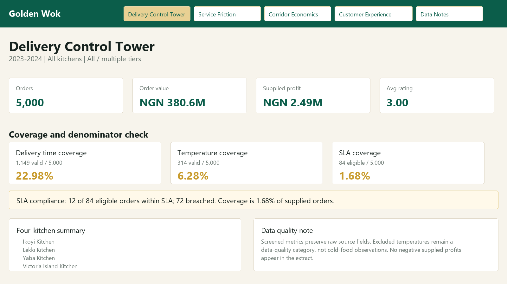

# Golden Wok: Delivery Performance and Data Quality

This Power BI project analyzes Golden Wok food delivery performance across 5,000 orders, focusing on delivery performance, profitability, customer experience, and data quality. The report highlights business results while clearly separating valid analytical records from source-data issues in delivery time, food temperature, and SLA coverage.

[View report PDF](GW.pdf) · [Download Power BI source](jongoGW.pbix)

## Business question

How can delivery managers assess commercial performance while accounting for incomplete and implausible operational measurements?

## Tools

- Power BI
- CSV source data

## Key Metrics

- Orders: 5,000
- Order value: NGN 380.6M
- Delivery cost: NGN 30.5M
- Supplied profit: NGN 2.49M
- Valid delivery-time observations: 1,149
- Valid temperature observations: 314
- SLA coverage: 84 eligible orders, with 12 compliant and 72 breached

## Files

- `jongoGW.pbix` - final Power BI report
- `GW.pdf` - exported report PDF
- `out/control_tower.png` - dashboard image used for the submission post
- `data/` - source CSV files used in the report

## Note

The dashboard keeps data-quality limitations visible. Delivery-time, temperature, and SLA metrics use screened records so the conclusions are based on valid observations rather than implausible source values.

## Review & reuse

Start with the PDF for the finished analytical story. To inspect or adapt the report, download the repository and open `jongoGW.pbix` in Power BI Desktop; update source paths to the local `data/` directory if prompted.

The 5,000-order total is not the denominator for every metric: delivery-time, temperature and SLA measures use the screened subsets listed above. The supplied profit field should not be assumed to reconcile to order value less delivery cost without checking its definition. This is a portfolio case study, not a claim of verified operating results for a real client.

## Author

[Yusuf Abdallah Jongo](https://yusuf-jongo.vercel.app/) — Economist, Data Analyst & AI and Digital Solutions Builder.

